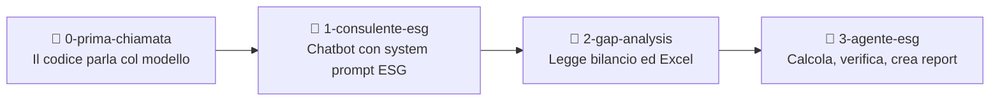

# ESG Copilot — Workshop

Materiale per un workshop pratico della **CoE Sustainability**: come un consulente ESG, senza essere sviluppatore, costruisce con il **Generative Engine di Capgemini** un agente che analizza un bilancio di sostenibilità, calcola le emissioni e trova gli errori.

Il workshop riprende, con il suo permesso, la struttura del [workshop di Marco Pastorello](https://github.com/markpast92/generative-engine-lesson): prompt per step e branch come checkpoint. Grazie Marco!

> **Il messaggio del workshop:** voi siete gli esperti di dominio, l'AI scrive il codice. E i numeri li calcola il codice, non li inventa il modello.

---

## Step preliminare — Installazione degli strumenti

✅ Installate **Visual Studio Code** dal **Portale Aziendale → Pre Approved Catalogue**.

Poi aprite il terminale **PowerShell integrato** di VS Code (**Terminale → Nuovo terminale**) ed eseguite:

### 1️⃣ Python

Va bene **Python 3.10 o successivo**. Se lo avete già, non serve aggiornarlo. Per una nuova installazione:

```powershell
winget install --id Python.Python.3.12 --exact
```

### 2️⃣ Git

```powershell
winget install --id Git.Git --exact --source winget
```

### 3️⃣ uv

```powershell
powershell -ExecutionPolicy ByPass -c "irm https://astral.sh/uv/install.ps1 | iex"
```

Al termine **chiudete e riaprite VS Code** e verificate:

```powershell
python check_requisiti.py
```

Dovete vedere `[OK]` per Python, Git e uv. Lo script non installa e non modifica nulla.

### 4️⃣ API key del Generative Engine

Su [generative.engine.capgemini.com](https://generative.engine.capgemini.com/) → **Studio** → **My API Keys and Usage** create una chiave. Il piano gratuito dà 4 $ al mese, più che sufficienti per tutto il workshop.

---

## Come usare questo repository

```powershell
git clone <URL-DI-QUESTO-REPOSITORY>
cd gen-eng-sust-workshop
```

Il branch `main` contiene **prompt** e **documenti di test**. Il codice funzionante è nei branch numerati:

```powershell
git checkout 0-prima-chiamata   # Step 0 — prima chiamata al modello
git checkout 1-consulente-esg   # Step 1 — chatbot consulente ESG
git checkout 2-gap-analysis     # Step 2 — upload documenti e gap analysis ESRS
git checkout 3-agente-esg       # Step 3 — agente con calcolo emissioni, grafici e report
```

In ogni branch:

1. copiate `.env.example` in `.env` e inserite la vostra chiave in `GEN_ENGINE_API_KEY`;
2. eseguite `uv sync`;
3. avviate: `uv run main.py` nello step 0, `uv run streamlit run app.py` dagli step 1 in poi.

> Il file `.env` contiene la vostra chiave: non condividetelo e non mostratelo a schermo. È già escluso da git.

---

## Gli step



| Step | Prompt | Branch | Cosa aggiunge |
|---|---|---|---|
| 0 | [`prompt/prompt_0.md`](prompt/prompt_0.md) | `0-prima-chiamata` | `main.py`: una domanda al modello dal terminale |
| 1 | [`prompt/prompt_1.md`](prompt/prompt_1.md) | `1-consulente-esg` | `app.py`, `config.py`, `engine.py`: chatbot web con il consulente ESG |
| 2 | [`prompt/prompt_2.md`](prompt/prompt_2.md) | `2-gap-analysis` | `extractor.py`: upload di PDF, Word ed Excel |
| 3 | [`prompt/prompt_3.md`](prompt/prompt_3.md) | `3-agente-esg` | `tools.py`, `generator.py`: calcolo emissioni, grafici, report scaricabili, foto |

Ogni step si costruisce incollando il prompt in un LLM, per esempio gli [agenti del Generative Engine](https://generative.engine.capgemini.com/agents). Dove il prompt dice `[incolla qui …]`, incollate i file prodotti nello step precedente. Se qualcosa non funziona al primo colpo, incollate l'errore all'LLM: di solito in uno o due passaggi è risolto. I branch sono i **checkpoint**: se vi perdete, ripartite da lì.

---

## Il caso di studio: Metallurgica Ardesia S.p.A.

In `doc_test/` ci sono i documenti di un'**azienda fittizia** che produce componenti metallici, con due stabilimenti (Piacenza e Cremona) e una sede a Milano.

| File | Contenuto |
|---|---|
| `Ardesia_Bilancio_Sostenibilita_2025.pdf` | Bilancio di sostenibilità 2025 (6 pagine, riferimento ESRS) |
| `Ardesia_consumi_2025.xlsx` | Consumi energetici mensili, flotta, gas refrigeranti, trasferte, fattori di emissione |

I documenti contengono **errori e lacune inseriti apposta**. Provate a farli trovare all'agente prima di leggere le soluzioni in fondo.

Domande da provare:

- *Step 2:* «Fai una gap analysis del bilancio rispetto all'ESRS E1: per ogni obbligo da E1-1 a E1-9 indica in tabella se è coperto, parziale o mancante, e perché.»
- *Step 3:* «Calcola le emissioni Scope 1, Scope 2 location-based e Scope 3 delle trasferte del 2025 dai dati di consumo, confrontale con il bilancio e spiegami le differenze. Poi crea un report Excel con i calcoli.»
- *Step 3:* «Fammi anche un PDF di una pagina per il cliente con un grafico delle emissioni per scope.»

I fattori di emissione nel file Excel sono **indicativi, a scopo formativo**: per un uso reale vanno verificati sull'ultima edizione delle fonti (ISPRA, DESNZ/DEFRA, IPCC).

---

## Modelli

| Modello | Quando usarlo |
|---|---|
| `amazon.nova-lite-v1:0` | Economico, adatto a domande semplici. Non supporta i tool. |
| `anthropic.claude-sonnet-4-6` | Più preciso, supporta tool e immagini. Usato nello step 3. |

Il modello si cambia in `config.py`. Il catalogo completo, con i prezzi per milione di token, è nel **Models catalog** dello Studio.

Il Generative Engine ha un endpoint negli Stati Uniti e uno in Europa. Con dati di clienti europei usate quello EU: si imposta con `GEN_ENGINE_BASE_URL` nel file `.env`.

---

<details>
<summary><b>Soluzioni: gli errori nascosti nei documenti di Ardesia</b></summary>

| # | Dove | Errore | Valore corretto (circa) |
|---|---|---|---|
| 1 | Excel | Cremona, settembre: energia inserita in Wh invece che in kWh | 281.450 kWh, non 281.450.000 |
| 2 | Excel | Milano, agosto: dato mancante, mentre il bilancio dice che non ci sono stime | — |
| 3 | Bilancio | Scope 2 calcolato con il fattore ISPRA del 2023 (0,256) invece di quello 2025 (0,213) | 2.211 t CO2e contro 2.657 dichiarate |
| 4 | Bilancio | Scope 1 senza le ricariche di gas refrigeranti del registro F-gas | 1.135 t CO2e contro 1.106 dichiarate |
| 5 | Bilancio | Scope 3 dichiarato non materiale | Solo le trasferte valgono circa 14,6 t CO2e; per un'azienda metalmeccanica l'acciaio acquistato è di solito la voce principale |
| 6 | Bilancio | Lacune ESRS E1 | Manca il piano di transizione (E1-1); obiettivo senza anno base né perimetro (E1-4); mix energetico incompleto (E1-5); mancano market-based, Scope 3 e intensità per ricavi, circa 38,7 t CO2e per milione di euro (E1-6) |

</details>
