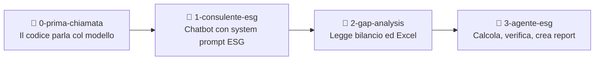

# Sustainability Copilot — Workshop

Materiale per un workshop pratico della **CoE Sustainability**: come un consulente ESG, senza essere sviluppatore, costruisce con il **Generative Engine di Capgemini** un agente che analizza un bilancio di sostenibilità, calcola le emissioni e trova gli errori.

Il workshop riprende, con il suo permesso, la struttura del [workshop di Marco Pastorello](https://github.com/markpast92/generative-engine-lesson): prompt per step e branch come checkpoint. Grazie Marco!

> **Il messaggio del workshop:** voi siete gli esperti di dominio, l'AI scrive il codice. E i numeri li calcola il codice, non li inventa il modello.

---

## Step preliminare — Installazione degli strumenti

✅ Installate **Visual Studio Code** dal **Portale Aziendale → Pre Approved Catalogue**.

Poi aprite il terminale **PowerShell integrato** di VS Code (**Terminale → Nuovo terminale**) ed eseguite:

### 1️⃣ Python

Va bene **Python 3.10 o successivo**. Se lo avete già, non serve aggiornarlo. Per una nuova installazione:

```powershell
winget install --id Python.Python.3.12 --exact
```

### 2️⃣ Git

```powershell
winget install --id Git.Git --exact --source winget
```

### 3️⃣ uv

```powershell
powershell -ExecutionPolicy ByPass -c "irm https://astral.sh/uv/install.ps1 | iex"
```

Al termine **chiudete e riaprite VS Code**, riaprite il terminale PowerShell integrato e verificate che tutto sia installato:

```powershell
python --version
git --version
uv --version
```

Ogni comando deve rispondere con un numero di versione. Python deve essere 3.10 o successivo.

### 4️⃣ API key del Generative Engine

Su [generative.engine.capgemini.com](https://generative.engine.capgemini.com/) → **Studio** → **My API Keys and Usage** create una chiave. Il piano gratuito dà 4 $ al mese, più che sufficienti per tutto il workshop.

---

## Come usare questo repository

```powershell
git clone https://github.com/skunkrm/gen-eng-sust-workshop.git
cd gen-eng-sust-workshop
```

### Verifica automatica dei requisiti

Dopo il clone, prima di passare ai branch numerati:

```powershell
python check_requisiti.py
```

In alternativa aprite `check_requisiti.py` in VS Code e cliccate **▶ Esegui file Python** in alto a destra (se il pulsante non c'è, installate l'estensione **Python** di Microsoft). Dovete vedere `[OK]` per Python, Git e uv. Lo script non installa e non modifica nulla.

Il branch `main` contiene **prompt** e **documenti di test**. Il codice funzionante è nei branch numerati:

```powershell
git checkout 0-prima-chiamata   # Step 0 — prima chiamata al modello
git checkout 1-consulente-esg   # Step 1 — chatbot consulente ESG
git checkout 2-gap-analysis     # Step 2 — upload documenti e gap analysis ESRS
git checkout 3-agente-esg       # Step 3 — agente con calcolo emissioni, grafici e report
```

In ogni branch:

1. copiate `.env.example` in `.env` e inserite la vostra chiave in `GEN_ENGINE_API_KEY` (per l'host europeo, togliete il `#` davanti alla riga `GEN_ENGINE_BASE_URL` con `generative-eu` e mettetelo davanti a quella US);
2. eseguite `uv sync`;
3. avviate: `uv run main.py` nello step 0, `uv run streamlit run app.py` dagli step 1 in poi.

Per esempio, per lo step 0:

```powershell
git checkout 0-prima-chiamata
Copy-Item .env.example .env
code .env
uv sync
uv run main.py
```

`code .env` apre il file in VS Code per inserire la chiave. Il file `.env` resta solo sul vostro PC e passa da un branch all'altro, quindi basta crearlo una volta.

> Il file `.env` contiene la vostra chiave: non condividetelo e non mostratelo a schermo. È già escluso da git.

---

## Gli step



| Step | Prompt | Branch | Cosa aggiunge |
|---|---|---|---|
| 0 | [`prompt/prompt_0.md`](prompt/prompt_0.md) | `0-prima-chiamata` | `main.py`: una domanda al modello dal terminale |
| 1 | [`prompt/prompt_1.md`](prompt/prompt_1.md) | `1-consulente-esg` | `app.py`, `config.py`, `engine.py`: chatbot web con il consulente ESG |
| 2 | [`prompt/prompt_2.md`](prompt/prompt_2.md) | `2-gap-analysis` | `extractor.py`: upload di PDF, Word ed Excel |
| 3 | [`prompt/prompt_3.md`](prompt/prompt_3.md) | `3-agente-esg` | `tools.py`, `generator.py`: calcolo emissioni, grafici, report scaricabili, foto |

Ogni step si costruisce incollando il prompt in un LLM, per esempio gli [agenti del Generative Engine](https://generative.engine.capgemini.com/agents). Dove il prompt dice `[incolla qui …]`, incollate i file prodotti nello step precedente. Se qualcosa non funziona al primo colpo, incollate l'errore all'LLM: di solito in uno o due passaggi è risolto. I branch sono i **checkpoint**: se vi perdete, ripartite da lì.

---

## Il caso di studio: Metallurgica Ardesia S.p.A.

In `doc_test/` ci sono i documenti di un'**azienda fittizia** che produce componenti metallici, con due stabilimenti (Piacenza e Cremona) e una sede a Milano.

| File | Contenuto |
|---|---|
| `Ardesia_Bilancio_Sostenibilita_2025.pdf` | Bilancio di sostenibilità 2025 (6 pagine, riferimento ESRS) |
| `Ardesia_consumi_2025.xlsx` | Consumi energetici mensili, flotta, gas refrigeranti, trasferte, fattori di emissione |

I documenti contengono **errori e lacune inseriti apposta**. Provate a farli trovare all'agente prima di leggere le soluzioni in fondo.

Domande da provare:

- *Step 2:* «Fai una gap analysis del bilancio rispetto all'ESRS E1: per ogni obbligo da E1-1 a E1-9 indica in tabella se è coperto, parziale o mancante, e perché. Rispondi solo con la tabella.» Provatela con Nova Lite e con Haiku 5.5.
- *Step 3:* «Calcola le emissioni Scope 1, Scope 2 location-based e Scope 3 delle trasferte del 2025 dai dati di consumo, confrontale con il bilancio e spiegami le differenze. Poi crea un report Excel con i calcoli.»
- *Step 3:* «Fammi anche un PDF di una pagina per il cliente con un grafico delle emissioni per scope.»

### Digital Product Passport: la staffa SP-220

In `doc_test/dpp/` ci sono i documenti di un componente di Ardesia, la staffa di supporto SP-220:

| File | Contenuto |
|---|---|
| `Ardesia_SP220_distinta_base.xlsx` | Dati di prodotto, distinta base con fornitori, consumi di processo per pezzo |
| `Certificato_Valtrebbia_AV-25-11873.pdf` | Certificato 3.1 dell'acciaieria, con contenuto riciclato e impronta di carbonio da EPD |
| `Certificato_CSL_CSL-25-0412.pdf` | Certificato 3.1 del centro servizi che fornisce la piastra di rinforzo |
| `Scheda_tecnica_SP-220.pdf` | Scheda tecnica con istruzioni di smontaggio e fine vita |

Nello step 3, dopo aver caricato i quattro file, scrivete: «Crea il Digital Product Passport della staffa SP-220 dai documenti caricati, in JSON e in PDF.» Lo schema dei campi, con fonte e citazione per ognuno, e le regole per la carbon footprint sono già nelle istruzioni dell'agente (`config.py`).

**Il codice controlla l'AI.** Prima di creare il JSON, lo strumento verifica che ogni citazione dei campi "documentato" compaia davvero nei documenti caricati, e che i campi "mancante" non abbiano un valore. Se la verifica non passa, il file non viene creato e il modello deve correggersi: nel pannello dell'agente vedete quali campi non tornano.

**Anche l'inventario lo calcola il codice.** Nello step 3 lo strumento `calcola_inventario` legge direttamente l'Excel dei consumi, segnala e corregge le anomalie, e restituisce i totali; `crea_report_inventario` genera l'Excel con le formule e il confronto con il bilancio. Il modello non ricopia valori e non fa somme a mente: commenta i risultati.

Il DPP è **dimostrativo**: i requisiti di dettaglio per i prodotti in acciaio dipenderanno dall'atto delegato previsto dal Regolamento ESPR (UE) 2024/1781.

### Foto dal vivo

Lo step 3 accetta anche foto (PNG o JPG). Esempio: la foto di una ciabatta sovraccarica o di uno scaffale ingombro, con la domanda «Sei un ispettore HSE: elenca le possibili non conformità visibili nella foto e crea un breve verbale in PDF.» Il verbale lo impagina lo strumento `crea_verbale_hse`: dati del sopralluogo, foto, non conformità con priorità, azioni correttive, limiti e firme. Serve un modello che accetti immagini.

I fattori di emissione nel file Excel sono **indicativi, a scopo formativo**: per un uso reale vanno verificati sull'ultima edizione delle fonti (ISPRA, DESNZ/DEFRA, IPCC).

---

## Modelli

| Modello | Quando usarlo |
|---|---|
| `amazon.nova-lite-v1:0` | Il più economico. Nello step 2 è il termine di confronto: sbaglia proprio dove serve. Non supporta i tool. |
| `anthropic.claude-haiku-5-5` | Veloce ed economico (circa 20 volte meno di Sonnet), supporta tool e immagini. Predefinito negli step 1 e 3, e il modello buono del confronto nello step 2. |
| `anthropic.claude-sonnet-5-5` | Il più potente e il più costoso. Sull'host europeo scrive lentamente: una gap analysis lunga può superare i 3 minuti. |

Il modello si cambia in `config.py`. Il catalogo completo, con i prezzi per milione di token, è nel **Models catalog** dello Studio.

Il Generative Engine ha un endpoint negli Stati Uniti e uno in Europa, ciascuno con il suo budget gratuito. Con dati di clienti europei, o se il budget US è finito, usate quello EU: nel file `.env` impostate `GEN_ENGINE_BASE_URL=https://openai.generative-eu.engine.capgemini.com/v1`.

> **Attenzione ai costi.** I prezzi per milione di token cambiano molto da modello a modello: Sonnet costa circa 20 volte Haiku. Con Sonnet le prove complete dello step 3 possono esaurire i 4 $ mensili in un'ora; con Haiku costano pochi centesimi.

---

## L'interfaccia

Dagli step 1 a 3 l'app ha la stessa veste: tema scuro e chiaro (pulsante ☀ nell'intestazione), sfondo animato e il pannello **Tempi e costi** a destra, richiudibile, con il cronometro di ogni richiesta, i token divisi in input e output e il costo calcolato con i prezzi del modello scelto. Sotto ogni risposta trovate tempo, token, costo e modello di quella richiesta.

La grafica sta tutta in `ui.py` e `.streamlit/config.toml`: non viene dai prompt degli step, ma è stata costruita allo stesso modo, descrivendo all'AI cosa si voleva vedere e rifinendo una richiesta alla volta. Cambiatela come volete: il resto dell'app non ne dipende.

In alto nell'intestazione c'è anche il pulsante per il **tutto schermo** (si esce con Esc).

---

<details>
<summary><b>Soluzioni: gli errori nascosti nei documenti di Ardesia</b></summary>

| # | Dove | Errore | Valore corretto (circa) |
|---|---|---|---|
| 1 | Excel | Cremona, settembre: energia inserita in Wh invece che in kWh | 281.450 kWh, non 281.450.000 |
| 2 | Excel | Milano, agosto: dato mancante, mentre il bilancio dice che non ci sono stime | — |
| 3 | Bilancio | Scope 2 calcolato con il fattore ISPRA del 2023 (0,256) invece di quello 2025 (0,213) | 2.211 t CO2e contro 2.657 dichiarate |
| 4 | Bilancio | Scope 1 senza le ricariche di gas refrigeranti del registro F-gas | 1.135 t CO2e contro 1.106 dichiarate |
| 5 | Bilancio | Scope 3 dichiarato non materiale | Solo le trasferte valgono circa 14,6 t CO2e; per un'azienda metalmeccanica l'acciaio acquistato è di solito la voce principale |
| 6 | Bilancio | Lacune ESRS E1 | Manca il piano di transizione (E1-1); obiettivo senza anno base né perimetro (E1-4); mix energetico incompleto (E1-5); mancano market-based, Scope 3 e intensità per ricavi, circa 38,7 t CO2e per milione di euro (E1-6) |

**Digital Product Passport della staffa SP-220**

| # | Dove | Cosa deve emergere |
|---|---|---|
| 7 | Certificato CSL | La piastra di rinforzo non ha origine, contenuto riciclato né impronta di carbonio: va usato un dato secondario (worldsteel, 1,92 kg CO2/kg) e segnalato |
| 8 | Distinta base | Manca la dichiarazione del fornitore delle viti, il GTIN è "da assegnare" |
| 9 | Scheda tecnica | L'affermazione "oltre il 90% di acciaio riciclato" non è supportata: l'unico dato documentato è l'87% del corpo staffa |
| 10 | Calcolo | Carbon footprint dalla culla al cancello circa 4,45 kg CO2e per pezzo, di cui circa il 31% da dati secondari; esclusi vernice e imballo, per cui mancano fattori |

</details>
